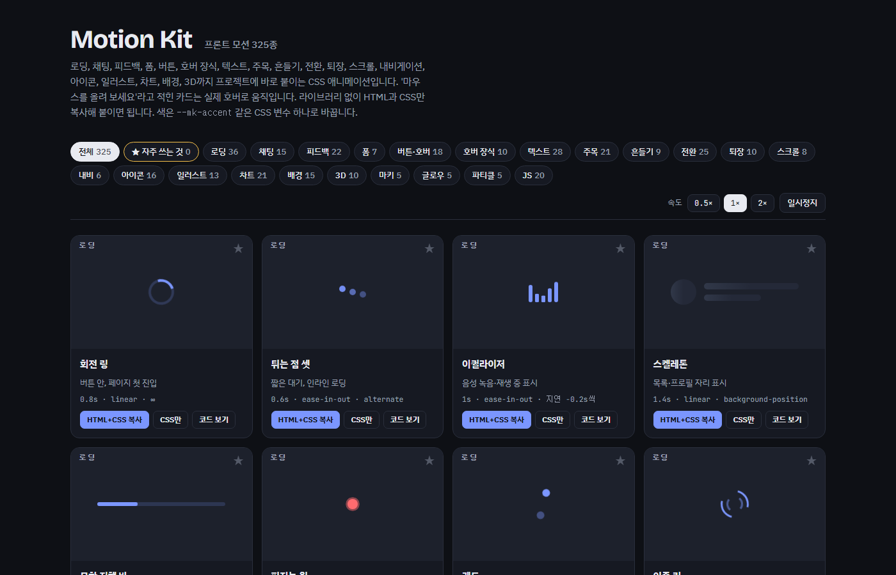

# Motion Kit

프론트엔드에 바로 붙여 쓰는 애니메이션 325종. CSS 305종은 HTML과 CSS만, JS 20종은 라이브러리 없는 순수 자바스크립트를 함께 씁니다.

- 갤러리: https://ssoyoum.github.io/motion-kit/



- 하나씩 보기: [`motions/`](motions/) (모션마다 완성된 HTML 한 파일)
- 전체 목록: [`목록.txt`](목록.txt)

| 분류 | 수 |
|---|---|
| 로딩 | 36 |
| 채팅 | 15 |
| 피드백 | 22 |
| 폼 | 7 |
| 버튼·호버 | 18 |
| 호버 장식 | 10 |
| 텍스트 | 28 |
| 주목 | 21 |
| 흔들기 | 9 |
| 전환 | 25 |
| 퇴장 | 10 |
| 스크롤 | 8 |
| 내비 | 6 |
| 아이콘 | 16 |
| 일러스트 | 13 |
| 차트 | 21 |
| 배경 | 15 |
| 3D | 10 |
| 마키 | 5 |
| 글로우 | 5 |
| 파티클 | 5 |
| JS | 20 |

## 쓰는 법
1. 갤러리에서 고르고 **HTML+CSS 복사**를 누르거나, `motions/` 파일을 엽니다.
   - 카드 오른쪽 위 ★을 누르면 **★ 자주 쓰는 것** 필터에 모이고, 거기서 모은 것을 한 번에 복사할 수 있습니다. 목록은 브라우저에 저장됩니다.
2. `마우스를 올려 보세요`·`클릭해 보세요`가 붙은 항목은 실제 `:hover`·`:focus`로 동작합니다.
3. 색은 CSS 변수로 바꿉니다: `--mk-accent`, `--mk-ink`, `--mk-danger`, `--mk-success`, `--mk-warn` 등. 변수가 없으면 기본색이 들어갑니다.
4. 미리보기는 무한 반복입니다. 한 번만 재생하려면 `infinite`를 지웁니다.
5. **JS** 분류는 `HTML+CSS+JS 복사`로 `<script>`까지 함께 복사됩니다. 스크립트는 `.mk-<id>` 요소마다 따로 붙어서 한 페이지에 여러 개 써도 됩니다.
6. 실제 서비스에서는 `@media (prefers-reduced-motion: reduce)`로 끄는 것을 권합니다.

## 고치고 다시 만들기
기본 모션은 `src/motion-kit.html`의 `/*DATA*/ … /*END*/` 사이에, 추가 모션은 `src/parts/*.js`에 있습니다. 새 파트는 `node tools/check-part.js src/parts/<파일>.js`로 먼저 검사합니다. 고친 뒤:

```
node tools/build.js src/motion-kit.html .
```

`index.html`, `motions/`, `목록.txt`가 다시 만들어집니다.
